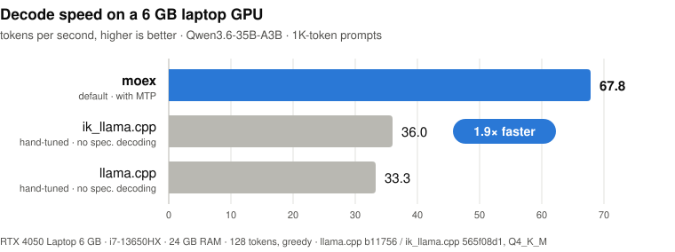
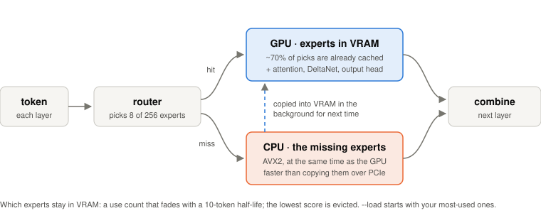

<div align="center">

# moex

**Run Qwen3.6-35B-A3B at 46 tokens/s on a 6 GB laptop GPU.**<br>
A 35-billion-parameter model, 2.3x faster than llama.cpp, with nothing to install but the NVIDIA driver.

[](https://github.com/neerajdad123-byte/moe/releases/latest)


[](LICENSE)



</div>

## Get started in 3 steps

You need: Windows 10/11, an NVIDIA RTX 20 series or newer GPU with 6 GB+ VRAM, a recent NVIDIA driver, 22 GB of free
disk and ideally 24 GB of RAM (less works, more slowly). No CUDA toolkit, no Python.

**1. Install moex.** In PowerShell:

```powershell
irm https://raw.githubusercontent.com/neerajdad123-byte/moe/main/install.ps1 | iex
```

This puts `moex` (1.3 MB) in `%LOCALAPPDATA%\Programs\moex` and on your PATH, so it works in any terminal (open a new
one after installing). Run it again to update. Or download
[`moex-windows-x64.zip`](https://github.com/neerajdad123-byte/moe/releases/latest) and unzip it anywhere.

**2. Download the model.** In any terminal:

```bat
moex download
```

This fetches the model (22 GB) from Hugging Face into `models\` next to `moex.exe`. It resumes where it left off, so if
your connection drops, just run it again.

**3. Chat.**

```bat
moex chat --load
```

```text
[before load] RAM 18.8 GB free of 25.5 GB | VRAM 5.3 GB free of 6.4 GB
[load] 1496 most-used experts preloaded into VRAM
[after load] RAM 0.3 GB free of 25.5 GB | VRAM 0.3 GB free of 6.4 GB  (by design: free VRAM became expert slots, RAM holds the experts)

Now the stage is yours.

> Explain in 3 sentences why the sky is blue.
Sunlight reaches Earth's atmosphere and is scattered in all directions by the gases and particles in the air. Blue
light is scattered more than other colors because it travels in shorter, smaller waves. This phenomenon, known as
Rayleigh scattering, is why we see a blue sky most of the time.
[60 tokens, 44.5 tok/s, first token 0.43 s, context 84]
```

`--load` takes about 30 seconds, then every reply runs at full speed. Without it the prompt appears in ~7 seconds, but
the first replies are slower while the model finishes loading into RAM. RAM and VRAM look full after loading on
purpose: free VRAM becomes expert cache, and the experts stay in RAM so the CPU never waits on the disk.

<details>
<summary><b>Other ways to get the model</b></summary>

The model is [Kreuzzelg/qwen36-35b-a3b-colibri-i4-gs64](https://huggingface.co/Kreuzzelg/qwen36-35b-a3b-colibri-i4-gs64)
on Hugging Face. You can also download it with the Hugging Face CLI, or file by file from the website, into any folder:

```bat
hf download Kreuzzelg/qwen36-35b-a3b-colibri-i4-gs64 --local-dir D:\models\qwen36
moex chat --load --model D:\models\qwen36
```

`--model DIR` (or the `MOEX_MODEL` environment variable) tells moex where the model is. `moex download --model DIR`
downloads to that folder instead.

</details>

## Chat options

Type a message and press Enter. `/reset` starts a new conversation, `/exit` quits. Speed is shown after every reply.

| Option | What it does |
|---|---|
| `--load` | preload your most-used experts into VRAM and all experts into RAM before the prompt |
| `--system "You are ..."` | system prompt |
| `--think` | let the model reason step by step before it answers |
| `--temp 0.7 --top-p 0.8 --top-k 20` | sampling (these are the defaults; `--temp 0` always picks the likeliest token) |
| `--seed N` | the same answer every time for the same input |
| `--ctx 8192` | context length in tokens; long contexts work (26,500 tested), each 1,000 tokens costs ~10 MB of VRAM |
| `--model DIR` | model folder (default: `models\` next to `moex.exe`) |

## Use it from other apps

```bat
moex serve --load
```

This starts an OpenAI-compatible API at `http://127.0.0.1:8765/v1`. Point any OpenAI-compatible app at it (Open WebUI,
editor plugins, the `openai` Python package, ...): model `qwen3.6-35b-a3b`, any API key.

```python
from openai import OpenAI
client = OpenAI(base_url="http://127.0.0.1:8765/v1", api_key="none")
for chunk in client.chat.completions.create(model="qwen3.6-35b-a3b", stream=True,
                                            messages=[{"role": "user", "content": "Hello!"}]):
    print(chunk.choices[0].delta.content or "", end="")
```

Supported: streaming, `temperature`, `top_p`, `top_k`, `seed`, `stop`, `max_tokens`,
`chat_template_kwargs.enable_thinking`. Apps that resend the whole conversation each turn only pay for the new message.
It listens on your machine only; `--host 0.0.0.0 --port N` changes that.

## Speed

| | decode speed |
|---|---|
| **moex** | **46.2 tokens/s** on average, 41-53 depending on the prompt |
| llama.cpp, default settings | 20.3 tokens/s |

- First token after you press Enter: ~0.4-0.9 s. Long documents are read at ~110-140 tokens/s.
- A 26,500-token conversation still decodes at ~30 tokens/s.

Measured on an RTX 4050 Laptop 6 GB, i7-13650HX, 24 GB RAM: the same model, 10 prompts neither engine had seen, the same
chat template, greedy decoding, 128 tokens each. llama.cpp b11563 (official CUDA build) on the ggml-org Q4_K_M GGUF,
which uses the same bit widths where it matters (int4 experts, int8 everything else). Script:
[`tools/h2h.py`](tools/h2h.py); every measurement is logged in [PLAN.md](PLAN.md).

**A bigger GPU makes it faster, automatically.** moex turns all free VRAM into expert cache. A 6 GB card holds ~1,600
of the 10,240 experts (15%), an 8 GB card ~2,700 (26%), a 12 GB card about half, and a 24 GB card all of them. Every
expert in VRAM is one the CPU doesn't have to compute.

**Tested machines** (v0.1.1, `moex chat`):

| GPU | CPU | RAM | decode |
|---|---|---|---|
| RTX 4050 Laptop, 6 GB | i7-13650HX | 24 GB | ~46 tokens/s (10-prompt benchmark above) |
| RTX 4060 Laptop, 8 GB | i7-13th gen HX | 24 GB | ~60 tokens/s (reported by a tester) |

Ran it on something else? Please [open an issue](https://github.com/neerajdad123-byte/moe/issues) with your GPU, RAM,
the `[load]` line and the tok/s you see.

## How it works

<div align="center">

</div>

Qwen3.6-35B-A3B is a mixture-of-experts model: 35B parameters in total, but each token uses only 8 of the 256 experts
in each of its 40 layers, about 3B parameters per token. The trick is keeping the right experts close.

- **An expert cache in VRAM.** Experts are cached one at a time, not whole layers, so the 6 GB go to the experts that
  are actually being used right now.
- **Choosing what stays.** Each expert's score is how often it was used, with older uses fading out (half-life of 10
  tokens); the lowest score is evicted. Picked by replaying real routing traces against the alternatives
  ([`tools/sim.py`](tools/sim.py)): it beat LRU, half-lives from 3 to 80 tokens, and predicting the next layer's experts
  (which added nothing). About 70% of the experts each token needs are already in VRAM.
- **Misses on the CPU, in parallel.** For one conversation it is faster to compute a missing expert on the CPU (AVX2)
  than to copy it over PCIe. The GPU and CPU work at the same time, and missing experts are copied into VRAM in the
  background for next time.
- **Warm start.** moex remembers which experts you use most (`moex_hot.bin` in the model folder; the release ships
  counts from 80 test prompts), and `--load` puts those in VRAM before you type.
- **Everything else on the GPU in int8.** Attention, the linear-attention (DeltaNet) layers and the output head live in
  VRAM. The KV cache is int8 too (4x smaller), and attention is spread across the whole GPU (flash-decoding), so long
  conversations stay fast.
- **No back-and-forth per layer.** The GPU looks up its cached experts itself, results cross PCIe through mapped
  memory, and each layer is a single CUDA graph.
- **Prompts in chunks.** Long prompts are processed 256 tokens at a time, streaming each needed expert to the GPU once
  per chunk instead of once per token.

## Accuracy

moex runs the published int4 model as it is. With full-precision dense weights (`--f16`) it matches a PyTorch
reference implementation to 1e-12 (KL divergence). The default int8 dense weights and int8 KV cache add a mean KL of
0.003, and the top-1 token agrees with the reference 98.6% of the time. The model file itself is an int4 quantization
of Qwen3.6-35B-A3B made by others (see Credits), so it is not identical to the original BF16 weights.

## Supported today

| | |
|---|---|
| Model | **Qwen3.6-35B-A3B** (int4 gs64 weights from `moex download`). Text only. |
| GPU | NVIDIA RTX 20 / 30 / 40 / 50 series and newer datacenter cards, 6 GB VRAM or more |
| OS | Windows 10/11 |
| Use | one conversation at a time, one GPU |

Tested on one laptop so far (RTX 4050 6 GB, 24 GB RAM). If you run it on something else, please
[open an issue](https://github.com/neerajdad123-byte/moe/issues) with the `[load]` lines and the tok/s you see.

## Roadmap

- **Linux** build.
- **Aggressive mode:** more experts on the GPU (int4 for the dense layers that tolerate it, smaller buffers, context
  sized to what you use) and less RAM needed, so 16 GB machines run well.
- **More models:** other mixture-of-experts families (Qwen, DeepSeek, GLM, gpt-oss).
- **GGUF support:** load the GGUF files people already have, natively, no conversion.
- **MTP (multi-token prediction):** Qwen3.6 can draft extra tokens per step. The int4 files used today don't include
  that part of the model, so it comes with the next model format.
- Faster prompt reading, and several conversations at once in `moex serve`.

More plans will be announced soon.

## Building from source

Visual Studio 2026 (C++) and CUDA 13.x. `build.bat` builds `build\moex.exe` for RTX 20-50 series plus the test programs
(`build.bat dev` builds for your GPU only, faster); `package.bat` makes the release zip.

| Check | Command |
|---|---|
| every kernel vs reference outputs | `build\test_kernels.exe` (first: `python ref/qwen36_ref.py "The capital of France is" --n 8 --dump ref/golden`) |
| the whole model vs the reference | `build\moex.exe --check ref/eval1` |
| the tokenizer vs Hugging Face's | `python tools/check_tokenizer.py` |
| the API | `moex serve`, then `python tools/test_server.py` |

## License and credits

moex is MIT licensed ([LICENSE](LICENSE)). The model has its own license (Apache-2.0).

- Model: [Qwen3.6-35B-A3B](https://huggingface.co/Qwen/Qwen3.6-35B-A3B) by the Qwen team.
- int4 gs64 weights: [Kreuzzelg/qwen36-35b-a3b-colibri-i4-gs64](https://huggingface.co/Kreuzzelg/qwen36-35b-a3b-colibri-i4-gs64),
  in the format of the [colibri](https://github.com/JustVugg/colibri) project.
- [llama.cpp](https://github.com/ggml-org/llama.cpp), the reference point for speed.
